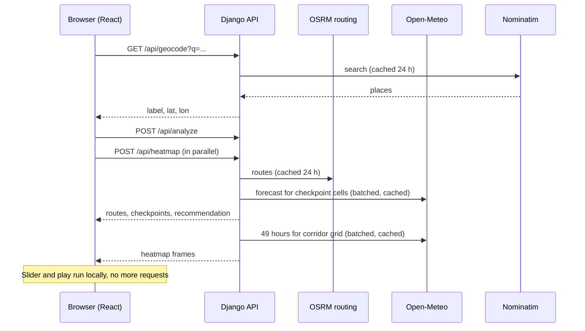

<div align="center">

# Haulwise

**Weather-aware route planning for truck drivers.**
Enter a trip, a departure time and a load weight. Haulwise checks the forecast for the moment your truck reaches each point on the road, scores the risk, and recommends the safest of three routes.


[**Live app**](https://frontend-orcin-alpha-70.vercel.app/) &nbsp;·&nbsp; [**Video walkthrough**](https://www.loom.com/share/YOUR-LOOM-ID) &nbsp;·&nbsp; [**API reference**](docs/API.md) &nbsp;·&nbsp; [**Risk rules**](docs/RISK_RULES.md)


</div>

---

## Table of contents

1. [What it does](#what-it-does)
2. [Screenshots](#screenshots)
3. [How a recommendation is made](#how-a-recommendation-is-made)
4. [Risk rules](#risk-rules)
5. [The heatmap](#the-heatmap)
6. [Architecture](#architecture)
7. [API overview](#api-overview)
8. [Design](#design)
9. [Performance and caching](#performance-and-caching)
10. [Getting started](#getting-started)
11. [Configuration](#configuration)
12. [Testing](#testing)
13. [Deployment](#deployment)
14. [Assumptions and design decisions](#assumptions-and-design-decisions)
15. [Limitations](#limitations)
16. [Troubleshooting](#troubleshooting)
17. [Data sources and attribution](#data-sources-and-attribution)
18. [Project structure](#project-structure)
19. [Author](#author)

---

## What it does

A truck driver cares about two things at once: how long the trip takes, and whether the weather along the way is safe for the load they are hauling. A normal routing app shows the weather where you are. Haulwise shows the weather where you **will be, when you get there**.

**You provide**

| Input | Notes |
|---|---|
| Origin and destination | US locations, found by search with autocomplete |
| Departure date and time | Entered in your browser's time zone, sent to the server in UTC |
| Load weight (lb) | Changes how wind is scored, see [Risk rules](#risk-rules) |

**You get**

- **Three route options** from a routing engine, with distance and driving time.
- **Checkpoints along each route** every 10, 25 or 50 miles (chosen by trip length), each with its **ETA**, forecast **wind, gusts, rain and snow** at that time, and a **risk level**.
- **A recommended route** with a plain-language reason, for example: *"No severe weather on this route. Route 2 has 50 mi."*
- **A risk ribbon** for every route: a strip that shows, in driving order, which stretches are calm and which are risky.
- **An interactive map** with all routes, the checkpoints of the selected route, and time differences between routes.
- **A forecast heatmap** of the whole trip corridor with a **0 to 48 hour slider**, so you can see where a storm is and how it moves, and decide whether to leave later.

### Feature list

| Area | Features |
|---|---|
| Routing | Up to 3 distinct routes, automatic fallback to find alternatives, duplicate-route removal, truck speed adjustment |
| Weather | Hourly forecast interpolated to each checkpoint's ETA, batched and cached requests |
| Risk | Five levels plus Unknown, load-aware wind rules, mile-weighted scoring, transparent "why" for every checkpoint |
| Recommendation | Order-independent ranking with tolerances, a safety gate for No Travel routes, plain-language explanation |
| Map | Risk-coloured route, white casing, muted alternates, delta pills, checkpoint popups, origin and destination pins |
| Heatmap | Corridor heat layer, 49 hourly frames, play and pause, toggle, legend, calm-forecast note |
| UX | Skeleton loading states, one orchestrated results reveal, keyboard navigation, reduced-motion support, mobile bottom sheet |
| Robustness | Clear error messages, partial-weather handling, rate limiting, server wake-up notice on free hosting |

---

## Screenshots

> Screenshots are in [`docs/images/`](docs/images/).

### Results: three routes, one recommendation

<p align="center">
  
</p>

The recommended route is taller and carries the big figures. Alternates are compact rows with how much slower or faster they are. The selected route is drawn on the map with risk-coloured stretches and a white outline.

### The risk ribbon

<p align="center">
  
</p>

Each ribbon shows the route left to right in driving order. Width is proportional to miles. A long green run with one orange stretch tells you where to pay attention without reading a table.

| Level | Colour | Marker | Also shown as |
|---|---|---|---|
| Low | Green | L | |
| Moderate | Yellow | M | |
| High | Orange | H | |
| Severe | Red | S | |
| No Travel | Near-black | X | Barricade stripe |
| Unknown (no forecast) | Grey | ? | Dotted fill |

Colour is never the only signal: markers carry a letter, and the ribbon uses patterns for No Travel and Unknown.

### Checkpoint details

<p align="center">
  
</p>

Every checkpoint explains itself: the ETA in local time with the zone, wind and gust, rain, snow, the resulting level, and the exact rule that decided it (for example *"wind 47 mph with load 34,000 lb: No Travel"*).

### Forecast heatmap with a time slider

<p align="center">
  
</p>

Drag the slider to see conditions across the whole corridor at any hour in the next 48. Press play to watch weather move. The slider never calls the server: all 49 frames are loaded once.

### Mobile

<p align="center">
  
</p>

On phones the map fills the screen and the results live in a bottom sheet with three snap positions.

### Loading and error states

<p align="center">
  
  &nbsp;&nbsp;
  
</p>

---

## How a recommendation is made

```mermaid
flowchart LR
  A["Origin, destination,<br/>departure, load"] --> B["Get up to 3 routes<br/>(OSRM + fallback)"]
  B --> C["Place checkpoints<br/>every 10, 25 or 50 mi"]
  C --> D["ETA at each checkpoint<br/>(departure + driving time)"]
  D --> E["Fetch hourly forecast<br/>(Open-Meteo, batched)"]
  E --> F["Interpolate weather<br/>to each ETA"]
  F --> G["Classify risk<br/>(thresholds + load rules)"]
  G --> H["Score miles by level<br/>per route"]
  H --> I["Rank routes<br/>and explain the winner"]
```



1. **Routes.** The routing engine returns up to three alternatives. When it returns fewer than three distinct routes, the server asks for extra routes through offset via-points (in parallel, with a time budget), drops any that are far longer than the shortest, and removes near-duplicates (more than 90% of the shorter route's miles within about 0.03 degrees of another route). Driving time is multiplied by 1.1 to approximate a loaded truck, since the public routing server uses a car profile.
2. **Checkpoints.** One at mile 0, one every 10, 25 or 50 miles depending on trip length, and one at the destination. Positions are interpolated along the route geometry.
3. **ETAs.** Departure time plus cumulative driving time to each checkpoint.
4. **Weather.** Checkpoints are snapped to a 0.1 degree grid so overlapping routes share requests. Each grid cell gets an hourly forecast. The two forecast hours around the ETA are linearly interpolated.
5. **Risk.** Wind, rain and snow are classified separately, the worst wins, and load rules can only raise the level.
6. **Scoring.** Each checkpoint owns the miles halfway to its neighbours. Miles are totalled per level, and an average risk score is computed weighted by miles.
7. **Ranking.** See below.

### Ranking routes

Routes are compared with a **filter cascade**. At each step, routes that are clearly worse are removed, and the remaining routes move to the next step:

| Step | Metric | Tolerance |
|---|---|---|
| Gate | Any No Travel miles | Routes with No Travel are never recommended while a legal route exists |
| 1 | Unknown (no forecast) miles | 5 mi |
| 2 | Severe miles | 5 mi |
| 3 | High miles | 5 mi |
| 4 | Average risk | 0.05 |
| 5 | Driving time | Shortest wins |

A route stays in the running if it is within the tolerance of the best value at that step. That way a 0.3-mile difference in severe weather cannot outweigh a three-hour detour, and the outcome does not depend on the order routes were returned in (tolerance-based comparisons are not transitive, so a normal sort would be unstable).

If every route contains No Travel conditions, no route is recommended and the app suggests leaving later, which the slider lets you explore.

The explanation names what eliminated the other routes first, then the tie-break among the rest, in plain words:

> *No severe weather on this route. Route 2 has 50 mi. Same weather risk as Route 3, and 64 min faster.*

---

## Risk rules

The full rules, with every boundary, are in [`docs/RISK_RULES.md`](docs/RISK_RULES.md). Summary:

### Thresholds

| Condition | Low | Moderate | High | Severe | No Travel |
|---|---|---|---|---|---|
| Wind (mph) | under 25 | 25 to 34 | 35 to 44 | 45 to 54 | 55 or more |
| Rain (in/hr) | under 0.10 | 0.10 to 0.25 | 0.25 to 0.50 | 0.50 to 1.00 | over 1.00 |
| Snow (in/hr) | under 0.5 | 0.5 to 1.0 | 1.0 to 2.0 | 2.0 to 3.0 | over 3.0 |

**Boundaries.** The ranges in the specification overlap at their edges, so a convention is fixed and tested. Wind includes the lower bound (35 mph is High). Rain and snow include the upper bound (exactly 1.00 in/hr rain is Severe, and above is No Travel).

### Load rules

Heavy loads are more exposed to crosswinds. These rules can only **raise** a level:

| Wind | Load | Result |
|---|---|---|
| 55 mph or more | any | No Travel |
| 45 to 54 mph | more than 30,000 lb | No Travel |
| 35 to 44 mph | more than 40,000 lb | at least Severe |

Load comparisons are strictly greater than: exactly 30,000 lb or 40,000 lb does not trigger the rule.

### Other rules

- **Checkpoint level** is the maximum of the wind, rain and snow levels, then load rules are applied.
- **Missing data is never "safe".** A checkpoint without a forecast is `unknown`, shown in grey, excluded from the average, and counted separately. A route with less forecast data cannot win just because its bad weather is invisible.
- **Every level is explained.** Each checkpoint carries a list of the rules that produced its level.

### Worked example

> A 42,000 lb truck reaches a checkpoint with 40 mph wind and light rain.
> Wind alone is **High** (35 to 44). Rain is Low. The maximum is High. The load rule (wind 35 to 44 and load over 40,000 lb) raises it to **Severe**. At 20,000 lb the same checkpoint stays High.

---

## The heatmap

The checkpoint markers answer *"what will the weather be where my truck is, when it gets there?"* The heatmap answers a different question: *"what does the weather look like across the whole corridor at a given hour, and how does it move?"* It lets a driver see a storm band approaching, judge whether leaving a few hours later or using another corridor avoids it, and spot weather beside the route.

**Backend** (`POST /api/heatmap`)

1. Build a corridor grid from all three routes: a point about every 20 to 25 miles along each route, plus two lateral offsets (about 15 miles either side), snapped to a 0.1 degree grid, capped at 300 points.
2. Fetch 49 hourly forecast values per grid point (hour 0 is the departure hour, up to +48 hours), reusing the same weather window and cache as route analysis.
3. Convert each hour to a **continuous intensity from 0 to 1** by piecewise-linear interpolation across the threshold table, so the colours blend smoothly instead of jumping between five bands. Load rules raise the intensity for heavy trucks in the same way they raise checkpoint levels.
4. Return compact arrays rounded to two decimals, gzip-compressed.

**Frontend**

- All 49 frames are fetched once. **Moving the slider makes no network request.**
- The heat layer is updated imperatively with `setLatLngs` on animation frames. The React tree and the route layers do not re-render while you scrub or play.
- The layer sits between the basemap and the route lines, and labels stay on top.
- Calm hours show a faint green glow plus the note *"Forecast is calm along this corridor at this hour."*, so an empty-looking map is never mistaken for a broken one.
- Play advances one hour every 400 ms. Turning the heatmap off removes the layer, stops playback and dims the controls.

> **Heatmap time versus checkpoint time.** Checkpoint markers use the weather at *your ETA*. The heatmap uses the weather at the *slider hour*. They are labelled differently on the map ("Weather at your ETA" and "Forecast heatmap") so they are not confused.

---

## Architecture

### System overview



The app is **stateless**: no user accounts and no database tables beyond Django's defaults. Caching uses Django's cache framework.

### Backend modules

| Module | Responsibility |
|---|---|
| `risk/config.py` | Every constant in one place: thresholds, tolerances, spacing table, speed factor |
| `risk/rules.py` | Wind, rain and snow classification, checkpoint level, load escalation, explanations |
| `risk/scoring.py` | Mile attribution, miles by level, mile-weighted average risk |
| `risk/recommend.py` | Filter-cascade ranking, No Travel gate, plain-language reason |
| `risk/intensity.py` | Continuous 0 to 1 intensity for the heatmap |
| `services/osrm.py` | Routes, via-waypoint fallback, duplicate removal, cumulative distance and time tables |
| `services/checkpoints.py` | Checkpoint spacing, positions and ETAs |
| `services/open_meteo.py` | Batched, threaded forecast fetch, grid snapping, caching, interpolation |
| `services/corridor.py` | Heatmap grid generation |
| `services/geocode.py` | Nominatim search with caching |
| `api/` | Request validation, views, throttling, response shaping |

**The `risk/` package is pure Python.** It does no HTTP, no I/O and imports nothing from Django, so the logic that matters most is deterministic and fully unit-tested.

### Frontend modules

| Module | Responsibility |
|---|---|
| `store/useTripStore.js` | Zustand state: form, analysis, status, selection, heatmap and playback |
| `api/client.js` | API calls and error flattening |
| `components/SearchForm` | Address spine, autocomplete, departure, load, validation, example trips |
| `components/RouteRows`, `RouteRibbon` | Route list, recommendation, risk ribbons |
| `components/MapView` | Basemap, routes, checkpoints, pins, delta pills, fit-to-bounds |
| `components/HeatLayer`, `HeatmapSlider` | Heat canvas and the control bar |
| `components/BottomSheet` | Mobile sheet with three snap points |
| `components/RouteSkeletons` | Loading placeholders shaped like the real rows |
| `styles/tokens.css`, `theme.js` | Design tokens and the Material UI theme |

---

## API overview

Full contracts and error tables are in [`docs/API.md`](docs/API.md).

| Method | Path | Purpose |
|---|---|---|
| `GET` | `/api/health` | Health check, used for the server wake-up notice |
| `GET` | `/api/geocode?q=` | Up to 5 US place matches |
| `POST` | `/api/analyze` | Routes, checkpoints, risk, recommendation |
| `POST` | `/api/heatmap` | 49-hour corridor intensity frames |

### Example: `POST /api/analyze`

```json
{
  "origin":      { "lat": 32.7767, "lon": -96.797,   "label": "Dallas, TX" },
  "destination": { "lat": 39.7392, "lon": -104.9903, "label": "Denver, CO" },
  "departure_time": "2026-10-14T09:40:00.000Z",
  "load_lbs": 42000,
  "checkpoint_interval_mi": null
}
```

Abbreviated response:

```json
{
  "recommended_route_id": "r1",
  "reason": "No severe weather on this route. Route 2 has 50 mi.",
  "warnings": [],
  "routes": [
    {
      "id": "r1",
      "distance_mi": 795.0,
      "duration_s": 56592,
      "interval_mi": 50,
      "blocked": false,
      "avg_risk": 0.13,
      "miles_by_level": {
        "low": 695.0, "moderate": 100.0, "high": 0.0,
        "severe": 0.0, "no_travel": 0.0, "unknown": 0.0
      },
      "geometry": [[-96.7968, 32.7759], "..."],
      "checkpoints": [
        {
          "mile": 0.0,
          "lat": 32.77594,
          "lon": -96.79675,
          "eta": "2026-10-14T09:40:00Z",
          "wind_mph": 8.1,
          "gust_mph": 23.93,
          "rain_in_hr": 0.0,
          "snow_in_hr": 0.0,
          "level": "low",
          "drivers": [
            "wind 8.1 mph -> Low",
            "rain 0.00 in/hr -> Low",
            "snow 0.00 in/hr -> Low"
          ]
        }
      ]
    }
  ],
  "timings_ms": { "osrm_primary": 1707.8, "weather": 4447.4, "scoring": 0.0 }
}
```

Notes: `avg_risk` is `null` when a route has no forecast data at all. `level` is one of `low`, `moderate`, `high`, `severe`, `no_travel`, `unknown`. `timings_ms` is an optional debugging aid.

### Error responses

| Status | Meaning |
|---|---|
| `400` | Invalid input: bad coordinates, load of 0 or less, same origin and destination, departure outside the forecast window. The body lists problems by field |
| `422` | No drivable route between the two places |
| `429` | Too many requests (rate limited) |
| `502` | The routing service failed |

Weather failures do **not** fail the request. Affected checkpoints become `unknown` and the response carries a warning.

---

## Design

The look comes from the subject: **US highway signage and old motor-club strip maps**. The full system is in [`docs/DESIGN_SYSTEM.md`](docs/DESIGN_SYSTEM.md).

- **One memorable element: the route ribbon.** A route read as a line, left to right, coloured by risk. Everything else is kept quiet so the ribbon carries the screen.
- **Colour.** Cool asphalt and concrete neutrals, a service-sign blue for actions, and risk colours that get darker as they get worse, so they still read without hue.
- **Type.** Barlow Condensed for figures and names, Barlow for everything else. Both come from highway lettering. Fonts are self-hosted.
- **Motion.** One orchestrated reveal after results arrive: the camera frames the trip, alternates draw in, the chosen route draws stretch by stretch, checkpoints pop in along it, and figures count up. Everything else only moves in response to something you did. All motion is removed for users who prefer reduced motion.
- **Skeletons.** Loading placeholders have the exact shape of the real rows, so nothing jumps when content arrives.
- **Copy.** Plain sentence-case wording. A button says what it does, errors say what happened and what to do, and internal ids never reach the screen.

| Token | Value | Use |
|---|---|---|
| `--ink` | `#14181B` | Primary text |
| `--panel` | `#F8F9F9` | Side panel |
| `--ground` | `#E6E9EA` | Behind panels |
| `--primary` | `#1456A0` | Actions and focus |
| `--risk-low` | `#2E9E6A` | Low |
| `--risk-moderate` | `#F2C200` | Moderate |
| `--risk-high` | `#EE7B1C` | High |
| `--risk-severe` | `#D1322F` | Severe |
| `--risk-no-travel` | `#1B1B1F` | No Travel |
| `--risk-unknown` | `#9AA3A8` | Unknown |

Accessibility: visible keyboard focus, arrow-key navigation through routes and the slider, level letters and text (not colour alone), and contrast checked for text and UI shapes.

---

## Performance and caching

Measured on a development machine. Re-measure on the hosted app before quoting these.

| Measurement | Result |
|---|---|
| Analyze, cold caches (long trip) | about 5 s |
| Analyze, same trip with a different load | under 0.5 s, with no routing or weather calls |
| Analyze, departure shifted by one hour | about 2 s, routes cached, weather refetched |
| Analyze, identical request | tens of milliseconds |
| Analyze response size | about 50 KB (geometry simplified to about 600 points per route) |
| Heatmap response size | about 12 KB gzip for about 270 grid points |
| Slider tick repaint | a few milliseconds, with no network and no map re-render |

| Cache | Key | Lifetime |
|---|---|---|
| Routes | origin and destination rounded to 3 decimals, in direction | 24 hours |
| Weather | 0.1 degree cell and time window | about 30 minutes |
| Geocoding | normalised query | 24 hours |
| Full analyze result | origin, destination, departure, load, interval | a few minutes |

Other measures: the fallback routing calls run in parallel under an 8-second budget, weather requests are batched and threaded, geometry is simplified before it is sent, and the map uses canvas rendering for lines.

---

## Getting started

### Prerequisites

- Python 3.13 (the version the project was built and tested on)
- Node.js (current LTS) and npm
- No API keys are needed

### 1. Clone

```bash
git clone https://github.com/Rishabh987654321/Weather-Aware-Truck-Routing.git
cd YOUR-REPO
```

### 2. Backend

macOS and Linux:

```bash
cd backend
python -m venv .venv
source .venv/bin/activate
pip install -r requirements.txt
cp .env.example .env          # then edit values
python manage.py migrate
python manage.py runserver    # http://localhost:8000
```

Windows (PowerShell):

```powershell
cd backend
python -m venv .venv
.venv\Scripts\Activate.ps1
pip install -r requirements.txt
Copy-Item .env.example .env   # then edit values
python manage.py migrate
python manage.py runserver    # http://localhost:8000
```

Check it works: open <http://localhost:8000/api/health>. You should see `{"status": "ok"}`.

### 3. Frontend

In a second terminal:

```bash
cd frontend
npm install
cp .env.example .env          # Windows: Copy-Item .env.example .env
npm run dev                   # http://localhost:5173
```

Open <http://localhost:5173>, pick the **Dallas to Denver** example, and press **Find safest route**.

> **Tip.** For an example with real weather, try **Chicago to Atlanta** and drag the heatmap slider to about +11 to +12 hours. Forecasts change daily, so calm days will show a mostly quiet map, which is correct.

---

## Configuration

### Backend (`backend/.env`)

| Variable | Required | Example | Purpose |
|---|---|---|---|
| `DJANGO_SECRET_KEY` | yes | long random string | Django secret key |
| `DEBUG` | no | `True` locally, `False` in production | Debug mode |
| `ALLOWED_HOSTS` | yes in production | `my-api.onrender.com` | Comma-separated host names |
| `CORS_ALLOWED_ORIGINS` | yes in production | `https://my-app.vercel.app` | Exact frontend origin, with `https://`, no trailing slash |
| `CONTACT_EMAIL` | yes | `you@example.com` | Put in the User-Agent for Nominatim and OSRM, as their usage policies ask |

### Frontend (`frontend/.env`)

| Variable | Required | Example | Purpose |
|---|---|---|---|
| `VITE_API_BASE_URL` | yes | `http://localhost:8000` | Where the backend lives |
| `VITE_TILE_URL` | no | `https://tile.openstreetmap.org/{z}/{x}/{y}.png` | Basemap tile URL template (defaults to OpenStreetMap standard tiles) |
| `VITE_TILE_ATTRIBUTION` | no | `&copy; OpenStreetMap contributors` | Basemap attribution string |
| `VITE_LABELS_TILE_URL` | no | `https://.../light_only_labels/{z}/{x}/{y}.png` | Optional separate top-layer labels tile URL (for two-layer basemaps) |

Tunable constants (thresholds, tolerances, spacing, speed factor) are all in [`backend/risk/config.py`](backend/risk/config.py).

---

## Testing

### Run

```bash
# backend (from backend/)
pytest
ruff check .
black --check .

# frontend (from frontend/)
npm test
npm run lint
```

External services are **always mocked** in tests, and real network calls are blocked by a guard so a test cannot silently depend on a live API.

### What is covered

| Area | Examples |
|---|---|
| Risk rules | Every threshold boundary for wind, rain and snow, each load rule, combinations, missing inputs |
| Scoring | Mile attribution adds up to the route distance, weighted averages, Unknown excluded |
| Recommendation | Each cascade step, No Travel gate, all-blocked case, tolerance edge cases, order independence across shuffled inputs, plain-language reasons |
| Checkpoints | Spacing at 149, 150, 500 and 501 miles, endpoints always included, monotonic ETAs |
| Routing | Parsing, fallback routes, duplicate removal, unsnappable via-points, no-route errors |
| Weather | Grid snapping, batching, hourly interpolation, out-of-window gives Unknown, partial failures, caching |
| Heatmap | Grid cap, intensity range and monotonic mapping, load escalation, response shape |
| API | Valid and invalid requests, error statuses, throttling, caching behaviour |
| Frontend | Form validation, recommended badge and blocked tag, colour and letter mapping, text mapping, null average risk, ribbon merging, markers never recreated while the slider plays, slider makes no network request |

See [`docs/TESTING.md`](docs/TESTING.md) for the full plan and the manual checks.

---

## Deployment

The backend and frontend deploy separately.

### Backend (Render or Railway)

| Setting | Value |
|---|---|
| Root directory | `backend` |
| Build command | `pip install -r requirements.txt && python manage.py collectstatic --noinput` |
| Start command | `gunicorn config.wsgi:application --workers 2 --threads 4 --timeout 60` |
| Python version | 3.13 |
| Environment | `DJANGO_SECRET_KEY`, `DEBUG=False`, `ALLOWED_HOSTS`, `CORS_ALLOWED_ORIGINS`, `CONTACT_EMAIL` |

Static files are served by WhiteNoise. Use the platform's `/api/health` as the health check.

### Frontend (Vercel or Netlify)

| Setting | Value |
|---|---|
| Root directory | `frontend` |
| Build command | `npm run build` |
| Output directory | `dist` |
| Environment | `VITE_API_BASE_URL=https://YOUR-BACKEND-URL` |

After the first deploy, set the backend's `CORS_ALLOWED_ORIGINS` to the frontend's exact URL and redeploy the backend.

> **Free hosting sleeps.** Free backend tiers pause after a period of inactivity, so the first request can take up to a minute. The app checks `/api/health` on load and shows *"Waking the server. This can take up to a minute."* if it is slow.

---

## Assumptions and design decisions

The assignment leaves several points open. These are the decisions made. All of them are in [`docs/ASSUMPTIONS.md`](docs/ASSUMPTIONS.md).

| Question | Decision | Reason |
|---|---|---|
| How often to sample? | Every 10 mi (under 150 mi), 25 mi (150 to 500), 50 mi (over 500). A manual override is available | Keeps long trips fast and short trips precise |
| Overlapping threshold edges | Wind includes the lower bound. Rain and snow include the upper bound | The spec says No Travel is strictly over 1.00 and over 3.0 |
| Which wind? | Sustained wind classifies risk. Gusts are shown in popups | The spec says "wind", and sustained wind is the standard reading |
| Snow units | Snowfall per hour in inches | Matches "in/hr" in the spec |
| Load rules | Raise levels only, strict greater-than | Matches the spec wording |
| Missing forecast | `unknown`, excluded from averages, ranked as a tier | Never treat missing data as safe |
| No Travel routes | Never recommended if a legal route exists | A closed-level route is not safely drivable, however fast |
| Risk against time | Ordered cascade with tolerances, not a pure lexicographic sort | A tiny weather difference should not justify a long detour |
| Truck routing | Public OSRM (car profile) with a 1.1× time factor | No free truck-routing service without keys |
| Time zones | UTC internally, browser time zone for display | Avoids mismatches between ETA and forecast |
| Persistence | None. Stateless app with caching | Nothing needs to be stored |

---

## Limitations

- **Car-profile routing.** The public OSRM server does not know about truck restrictions such as height, weight limits or hazmat rules. A truck-aware routing service would be the first upgrade.
- **No hours-of-service.** Driver rest breaks and legal driving limits are not part of ETAs.
- **Forecast range.** Weather comes from Open-Meteo, which limits how far ahead and behind forecasts are available. Checkpoints outside the window are shown as Unknown with a warning.
- **Free public services.** OSRM, Nominatim and Open-Meteo have usage policies and rate limits. The server caches and proxies them, sets a descriptive User-Agent, and never calls them from the browser. The free Open-Meteo tier is for non-commercial use.
- **US locations only** in search.
- **Map tile zoom cap.** Map zoom and tile layers are capped at zoom level 12 to eliminate excess bandwidth and 403 tile rate limits on corridor overviews, while comfortably framing short trips (e.g. Dallas to Fort Worth).
- **Per-process caches.** The default in-memory cache and rate limiting are per server process. A shared cache such as Redis would be the next step for multiple workers.
- **Free hosting cold starts**, see [Deployment](#deployment).

### Ideas for later

- Truck-aware routing (an `hgv` profile or a self-hosted engine)
- Suggest the best departure time in the next 48 hours
- Gust-aware load rules and a road-surface (ice) factor
- Redis for shared caching and rate limiting
- Saved trips and shareable links
- Radar and alert overlays

---

## Troubleshooting

| Problem | Likely cause and fix |
|---|---|
| The first request is very slow on the hosted app | The free server was asleep. Wait up to a minute, then retry |
| "Can't reach the server" | The backend is not running, or `VITE_API_BASE_URL` points to the wrong address |
| Browser console shows a CORS error | Set `CORS_ALLOWED_ORIGINS` to the exact frontend origin, with `https://` and no trailing slash |
| "Pick a departure between ..." | The departure is outside the forecast window. Choose a time within the range shown |
| Search finds nothing | Only US locations are supported. Try a city name |
| The heatmap looks empty | The forecast may be calm at that hour. A note says so. Try a different hour, or a trip with active weather |
| Route list shows fewer than 3 routes | The routing service returned fewer distinct options. A warning is shown |
| Some checkpoints are grey | Forecast data was not available for those times. They are excluded from the average |
| Tests fail with a network error | A test is making a real HTTP call. External services must be mocked |

---

## Data sources and attribution

| Source | Used for | Notes |
|---|---|---|
| [OSRM](https://project-osrm.org/) | Routes | Public demo server, car profile, usage policy applies |
| [Open-Meteo](https://open-meteo.com/) | Hourly wind, gusts, rain, snowfall | Free tier for non-commercial use, data licensed [CC BY 4.0](https://creativecommons.org/licenses/by/4.0/) |
| [Nominatim](https://nominatim.org/) and [OpenStreetMap](https://www.openstreetmap.org/copyright) | Place search | Data © OpenStreetMap contributors, ODbL. Usage policy applies |
| [OpenStreetMap](https://www.openstreetmap.org/copyright) standard tiles | Basemap tiles | Standard tiles © OpenStreetMap contributors, ODbL (configurable via `VITE_TILE_URL`) |
| [Leaflet](https://leafletjs.com/) and [leaflet.heat](https://github.com/Leaflet/Leaflet.heat) | Map and heat layer | |
| [Barlow](https://fonts.google.com/specimen/Barlow) | Typefaces | SIL Open Font License, self-hosted through Fontsource |

---

## Project structure

```text
.
├── README.md
├── docs/
│   ├── API.md                 endpoint contracts
│   ├── ARCHITECTURE.md        modules, pipelines, error handling
│   ├── ASSUMPTIONS.md         how ambiguous spec points were resolved
│   ├── RISK_RULES.md          thresholds, load rules, ranking
│   ├── TESTING.md             test plan and manual checks
│   ├── DESIGN_SYSTEM.md       visual language, tokens, motion, copy
│   └── images/                screenshots used in this README
├── backend/
│   ├── config/                Django settings, CORS, throttling, cache
│   ├── api/                   views, serializers, URLs
│   ├── risk/                  pure risk and recommendation logic
│   │   ├── config.py
│   │   ├── rules.py
│   │   ├── scoring.py
│   │   ├── recommend.py
│   │   └── intensity.py
│   ├── services/              OSRM, Open-Meteo, Nominatim, corridor, checkpoints
│   ├── tests/                 unit and API tests, mocked HTTP fixtures
│   ├── requirements.txt
│   └── .env.example
└── frontend/
    ├── src/
    │   ├── api/               API client
    │   ├── components/        form, route rows, ribbon, map, heatmap, sheet
    │   ├── store/             Zustand store
    │   ├── styles/            design tokens
    │   └── utils/             formatting and geometry helpers
    ├── package.json
    └── .env.example
```

---

## Author

Built by **Rishabh** as a full-stack assessment project.

[GitHub](https://github.com/Rishabh987654321) &nbsp;·&nbsp; [LinkedIn](https://www.linkedin.com/in/rishabh-kumar-730492233/?skipRedirect=true) &nbsp;·&nbsp;
[Email](mailto:[EMAIL_ADDRESS])

<sub>Route and weather data come from third-party services. Always follow official road conditions and your company's safety policies. This tool supports planning and does not replace the driver's judgement.</sub>